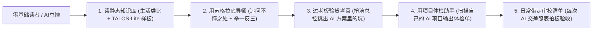

# 项目规格说明书（Spec）：《ArchPilot —— AI 时代零基础架构思维与工程总控开源指南》

> **项目代号**：`arch-pilot`  
> **文档版本**：`v1.0-spec`  
> **当前交付版本**：`v1.0.0`（6 周课程、9 份样板、3 合 1 套件、社区共建与 5 道自动化门禁全量闭环）  
> **工程归属**：独立外部开源仓库孵化（与真实生产工作区彻底隔离）  
> **许可协议**：代码/脚本/Skill 采用 **MIT**（见 `LICENSE-CODE`）；教程文本与图解采用 **CC-BY-NC 4.0**（见 `LICENSE-CONTENT`）

---

## 1. 背景、愿景与核心边界

### 1.1 问题定义
在 AI 辅助编程（Vibe Coding）普及的背景下，大量无软件工程基础的个人创造者、非技术创始人与超级个体普遍面临同一个断层：
- **起手快、维护崩**：让 AI 30 分钟做出原型很容易，但功能叠加到第 3–5 轮后开始“改 A 坏 B”、依赖缠成毛线团。
- **听不懂、不敢拍板**：AI 给出的架构建议满是黑话（聚合根、端口、乐观锁、事务回滚、TDD 等），非技术决策者无从判断好坏。
- **不会验货、怕踩暗坑**：只能听 AI 口头宣称“改好了”，不懂如何防止 AI 删文件、越权写数据、破坏旧功能或硬编码泄露隐私。

### 1.2 产品定位与边界（What It IS & IS NOT）
- **核心定位**：一套面向 AI 时代非技术创造者的 **“结构化开源知识库 + 3 合 1 AI 陪学与审校套件”**，用脱敏后的公开架构模型 `TALOS-Lite` 作为贯穿全书的活教材，帮助读者在 6 周内建立**架构判断力、边界意识与 AI 验收能力**。
- **明确不做（Non-Goals）**：
  - 不教零基础手敲编程语言语法、不刷算法题；
  - 不搭建需要付费运维的后端服务器、用户账号体系或自建大模型 API 代理（零服务器成本，静态托管 + 读者自备常用 AI）；
  - 不公开真实生产控制仓中的任何私有配置目录、本机真实绝对路径、私人业务记录或未授权商业源码。

---

## 2. 目标用户与使用闭环

- **核心种子用户**：正在使用 Cursor / Claude / ChatGPT / Antigravity / Codex 打造自己工具或产品的零基础玩家、非技术创始人与超级个体。
- **端到端学习与使用闭环**：

---

## 3. 核心内容与信息架构（6 周课程体系 + 脱敏案例）

### 3.1 统一教学标杆模型：`TALOS-Lite`（脱敏简化教学架构）
全书不采用脱离工程的玩具例子，而是将多智能体控制底座提炼为一个 **100% 脱敏、零隐私、仅含教学级概念与最小示意片段** 的公开架构模型 `TALOS-Lite`，涵盖 6 个通用架构积木与 **9 份 ≤60 行脱敏教学样板**：
1. **状态账本（State Ledger）**：项目进度档案 + 连续流水记录（`state-sample.json`、`state-schema-sample.json`、`event-chain-sample.jsonl`）。
2. **待审提议箱（Proposal Inbox）**：AI 只能写申请单入箱，人来点同意（`proposal-sample.json`）。
3. **工作区边界（Workspace Fence）**：主仓库与草稿分支隔离、真假账本分层（`workspace-binding-sample.json`、`truth-vs-index-sample.json`）。
4. **不可变资产盒 & 架构演进（Asset Box & Refactor）**：接口插座抽象与架构棘轮（`port-protocol-sample.py`、`ratchet-baseline-sample.json`）。
5. **执行安检门（Execution Guard）**：对高危命令与受保护文件的自动拦截（贯穿 Week 4–5 实战与考官题库）。
6. **能力身份证（Capability Manifest）**：插件/工具接入前必须申报权限与证据（`manifest-sample.json`）。

### 3.2 知识库与工具模块交付清单（全部在 `v1.0` 完成）

| 模块 / 阶段 | 核心学习目标 | 对应 `TALOS-Lite` 教学映射 | 交付状态 |
| :--- | :--- | :--- | :--- |
| **Start & FAQ** | 建立“总控看图纸、验房子”心智 + 解答高频 12 问 | `TALOS-Lite` 全景一张图 + 重构复盘 | ✅ `v1.0` 已交付 |
| **Week 1：数据与规则地基** | 看懂终端、路径安全、JSON 档案与 Schema 规则表 | `state-sample.json` + `state-schema-sample.json` | ✅ `v1.0` 完整精讲 |
| **Week 2：版本控制与真假账本** | 分清 Git 分支隔离、工作树、权威文本源 vs SQLite 派生索引 | `workspace-binding-sample.json` + `truth-vs-index-sample.json` | ✅ `v1.0` 完整精讲 |
| **Week 3：架构思维与单向分层** | 彻底懂 OOP 聚合根/不变量、耦合痛点、单向依赖、端口与适配器 | `port-protocol-sample.py` + `refactor-walkthrough.md` | ✅ `v1.0` 完整精讲 |
| **Week 4：并发、事务与人机隔离** | 懂乐观锁版本号、字节级核对、核态锁、WAL 草稿本、指纹与 AI 禁自批 | `proposal-sample.json` + `event-chain-sample.jsonl` | ✅ `v1.0` 完整精讲 |
| **Week 5：自动化测试与无损重构** | 懂 TDD 5 类考题、架构棘轮（只紧不松）与绞杀者渐进迁移 | `ratchet-baseline-sample.json` + 推倒重写评估红线 | ✅ `v1.0` 完整精讲 |
| **Week 6：平台边界与打包分发** | 懂纯业务内核与不可打包本机依赖剥离、MCP 与 Fail-Closed | `manifest-sample.json` + 综合大考指南 | ✅ `v1.0` 完整精讲 |
| **Toolkit & AI Kit** | 17 条大白话术语表 + 10 条交互清单 + 3 合 1 套件 + 离线 6 关题库 | 跨全部 6 周场景复用 | ✅ `v1.0` 完整交付 |

---

## 4. 3 合 1 AI 陪学套件规格（`v1.0.0`）

每个能力同时交付 **通用 Prompt（`prompts/`）** 与 **标准 Agent Skill（`skills/`）** 两种格式：

| 套件模块 | 定位与触发时机 | 核心契约规范 | 预期输出 |
| :--- | :--- | :--- | :--- |
| **1. 苏格拉底零基础导师** (`arch-tutor`) | 读某一章卡壳或想深挖概念时 | 零黑话；按“生活类比 → 极简图示与 TALOS-Lite 映射 → 一句话总控收口 → 1 个确认题”推进 | 四步互动教学回应 |
| **2. “老板验货”模拟考官** (`arch-examiner`) | 每周学完做实战演练时 | 每周 2 套轮换暗坑蓝图 + 综合大考；先提交藏坑方案，接招盘问后按 100 分制 4 维打分 | 模拟暗坑方案 → 揭晓与量化评分复盘 |
| **3. 真实项目体检助手** (`arch-auditor`) | 给自己的 AI 编程项目做诊断时 | **严格只读、禁止修改用户文件**；带只读脱敏自证声明与客观红黄绿灯标准 | 5 板块《大白话架构体检报告》+ 修复指令 |

---

## 5. 技术架构与 5 道自动化质量门禁

- **技术选型**：纯 Markdown 唯一事实源 + VitePress 静态文档站（中文本地检索 + Mermaid 图表 + 3 个轻量 Vue 交互组件）+ GitHub Actions 自动构建部署 GitHub Pages。

| 门禁编号 | 检查脚本 / 命令 | 强制拦截规则（CI 失败即阻断合并与发版） |
| :--- | :--- | :--- |
| **GATE-01 隐私脱敏** | `scripts/check_sanitization.py` | 禁止出现本机绝对路径前缀、私人敏感目录标识、疑似 API Key / Token / 私钥块。 |
| **GATE-02 源码边界** | `scripts/check_sanitization.py` | `docs/talos-lite/examples/` 下单文件严格 `<= 60` 行，禁止整文件复制未授权内部源码或真实进度。 |
| **GATE-03 套件一致性** | `scripts/check_prompt_sync.py` | 校验 `prompts/`、`skills/` 与 `docs/ai-kit/` 的版本号（`1.0.0`）及核心引用完全同步。 |
| **GATE-04 站点可用性** | `npm run docs:build` | VitePress 零报错、零内部死链、Mermaid 图表与 Vue 组件正常编译。 |
| **GATE-05 零基础可读性** | `scripts/check_readability_gate.py` | 校验 Week 1–6 无残留占位文案、每章含 Mermaid 图/免费资源/≥3 自检题/AI 引导、术语表 ≥16 条带显式锚点、Mermaid 无 ` ` 标签。 |

---

## 6. 版本里程碑

- **v0.1**：独立仓库初始化、VitePress 骨架、第 1 周精讲、术语表、审校清单、3 合 1 套件初版及 `GATE-01..04`。
- **v1.0（当前版本）**：补齐 Week 2–6 完整精讲、高频 12 问 FAQ、9 份 `TALOS-Lite` 脱敏样板、双向耦合重构复盘、套件升级至 `v1.0.0`、离线 6 关题库、平台安装指南、开源贡献模板及 `GATE-05` 自动化可读性门禁。
- **v1.1+（后续社区共建演进）**：按真实零基础试读反馈扩充新术语比喻、考官新暗坑案例与多语言扩展。
