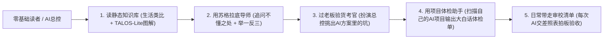

# 项目规格说明书（Spec）：《ArchPilot —— AI 时代零基础架构思维与工程总控开源指南》

> **项目代号**：`arch-pilot`  
> **文档版本**：`v1.0-spec`  
> **当前迭代阶段**：`v0.1`（MVP 闭环已落位）  
> **工程归属**：独立外部开源仓库孵化（与真实生产工作区彻底隔离）  
> **许可协议**：代码/脚本/Skill 采用 **MIT**（见 `LICENSE-CODE`）；教程文本与图解采用 **CC-BY-SA 4.0**（见 `LICENSE-CONTENT`）

---

## 1. 背景、愿景与核心边界

### 1.1 问题定义
在 AI 辅助编程（Vibe Coding）普及的背景下，大量无软件工程基础的个人创造者、非技术创始人与超级个体普遍面临同一个断层：
- **起手快、维护崩**：让 AI 30 分钟做出原型很容易，但功能叠加到第 3–5 轮后开始“改 A 坏 B”、依赖缠成毛线团。
- **听不懂、不敢拍板**：AI 给出的架构建议满是黑话（聚合根、端口、乐观锁、事务回滚、TDD 等），非技术决策者无从判断好坏。
- **不会验货、怕踩暗坑**：只能听 AI 口头宣称“改好了”，不懂如何防止 AI 删文件、越权写数据、破坏旧功能或硬编码泄露隐私。

### 1.2 产品定位与边界（What It IS & IS NOT）
- **核心定位**：一套面向 AI 时代非技术创造者的 **“结构化开源知识库 + 3 合 1 AI 陪学与审校套件”**，用脱敏后的公开架构模型 `TALOS-Lite` 作为贯穿全书的活教材，帮助读者在 6 周内建立**架构判断力、边界意识与 AI 验收能力**。
- **明确不做（Non-Goals）**：
  - 不教零基础手敲编程语言语法、不刷算法题；
  - 不搭建需要付费运维的后端服务器、用户账号体系或自建大模型 API 代理（零服务器成本，静态托管 + 读者自备常用 AI）；
  - 不公开真实生产控制仓中的任何私有配置目录、本机真实绝对路径、私人业务记录或未授权商业源码。

---

## 2. 目标用户与使用闭环

- **核心种子用户**：正在使用 Cursor / Claude / ChatGPT / Antigravity / Codex 打造自己工具或产品的零基础玩家、非技术创始人与超级个体。
- **端到端学习与使用闭环**：

---

## 3. 核心内容与信息架构（6 周课程体系 + 脱敏案例）

### 3.1 统一教学标杆模型：`TALOS-Lite`（脱敏简化教学架构）
全书不采用脱离工程的玩具例子，而是将多智能体控制底座提炼为一个 **100% 脱敏、零隐私、仅含教学级概念与最小示意片段** 的公开架构模型 `TALOS-Lite`，涵盖 6 个通用架构积木：
1. **状态账本（State Ledger）**：项目进度档案 + 连续流水记录（对应规则校验与防篡改）。
2. **待审提议箱（Proposal Inbox）**：AI 只能写申请单入箱，人来点同意（对应人机权限隔离）。
3. **工作区边界（Workspace Fence）**：主仓库与草稿分支隔离、公私数据分界（对应防写乱、防泄密）。
4. **不可变资产盒（Immutable Asset Box）**：成品快照独立存档、永不覆写（对应产物溯源）。
5. **执行安检门（Execution Guard）**：对高危命令与受保护文件的自动拦截（对应安全防线）。
6. **能力身份证（Capability Manifest）**：插件/工具接入前必须申报权限与证据（对应扩展治理）。

### 3.2 知识库目录树与 6 周课程大纲

| 模块 / 阶段 | 核心学习目标 | 对应 `TALOS-Lite` 教学映射 | 交付状态 |
| :--- | :--- | :--- | :--- |
| **Start（起步与地图）** | 打破“先学语法”误区，建立“总控看图纸、验房子”心智 | `TALOS-Lite` 全景一张图 | `v0.1` 已完成 |
| **Week 1：数据与规则地基** | 看懂终端、路径安全、JSON 档案与 Schema 规则表 | 精简样板 `state-sample.json` + 规则表对比 | `v0.1` 完整精讲 |
| **Week 2：版本控制与真假账本** | 分清 Git 分支隔离、工作树、权威文本源 vs SQLite 派生索引 | 主分支门禁 + 索引可重建原理 | `v0.2` 滚动精讲（v0.1 含预习导览） |
| **Week 3：架构思维与单向分层** | 彻底懂面向对象封装、耦合痛点、单向依赖、端口与适配器 | 6 大积木分工图 + 双向依赖改造对比 | `v0.3` 滚动精讲（v0.1 含预习导览） |
| **Week 4：并发、事务与人机隔离** | 懂乐观锁版本号、字节级核对、核态锁、WAL 草稿本、指纹与 AI 禁自批 | 并发冲突演示 + 提议箱审批流 | `v0.4` 滚动精讲（v0.1 含预习导览） |
| **Week 5：自动化测试与无损重构** | 懂 TDD、架构棘轮（只紧不松）与绞杀者渐进迁移 | “推倒重写 vs 原地绿地”对比 + 自动验房仪 | `v0.5` 滚动精讲（v0.1 含预习导览） |
| **Week 6：平台边界与打包分发** | 懂纯业务内核与不可打包本机依赖的物理剥离 | `Core` vs `Host Native` 分界图 | `v0.6` 滚动精讲（v0.1 含预习导览） |
| **Toolkit（常备工具箱）** | 日常高频即查即用 | 大白话术语翻译表 + 10 条交互式反问清单 | `v0.1` 全量完整交付 |

---

## 4. 3 合 1 AI 陪学套件规格

每个能力同时交付 **两种格式**：
- **格式 A（通用 Prompt 包）**：位于 `prompts/`，纯 Markdown 文本，站点支持**一键复制**，粘贴进任意主流大模型对话即可生效。
- **格式 B（标准 Agent Skill 包）**：位于 `skills/`，遵循标准 `SKILL.md` 结构，可直接安装进支持 Skill 的编程智能体。

| 套件模块 | 定位与触发时机 | 输入 | 强制行为规范（Prompt/Skill 契约） | 预期输出 |
| :--- | :--- | :--- | :--- | :--- |
| **1. 苏格拉底零基础导师** (`arch-tutor`) | 读某一章卡壳或想深挖概念时 | 章节号 / 困惑的黑话 / 读者背景 | 禁止堆砌未解释术语；先给**生活类比**，再给**精简图示**，最后只提 **1 个引导性小问题**确认真懂再推进 | 大白话拆解 + Mermaid 简图 + 1 个互动确认题 |
| **2. “老板验货”模拟考官** (`arch-examiner`) | 每周学完做实战演练时 | 选定周次（Week 1–6）或“综合大考” | 角色扮演“爱走捷径的程序员 AI”，提交藏有 2–3 处真实工程隐患的方案，等待用户挑刺后再复盘打分 | 模拟“带坑方案” → 接受用户挑刺 → 隐患揭晓与评分复盘 |
| **3. 真实项目体检助手** (`arch-auditor`) | 读者想给自己的 AI 编程项目做诊断时 | 本地目录（Skill）或文件树+说明（Prompt） | **严格只读、禁止修改任何用户文件**；扫描耦合、硬编码、隐私边界、测试覆盖与不可打包依赖；输出红/黄/绿灯大白话报告 | 《大白话架构体检报告》+ 可直接发给 AI 的修复指令 |

---

## 5. 技术架构与仓库目录规范

- **唯一事实源**：纯 Markdown（`.md`），兼容 GitHub / Obsidian / Typora 离线阅读。
- **文档站引擎**：**VitePress**（本地中文全文搜索 `local search` + Mermaid 图表渲染）。
- **自定义轻组件（仅 3 个）**：
  1. `<PromptCopyCard />`：直接引用 `prompts/*.prompt.md` 源文件内容并提供一键复制；
  2. `<GlossaryBadge />`：术语分类徽章与导航；
  3. `<ChecklistInteractive />`：纯前端 `localStorage` 本地勾选保存的 10 条审校清单。
- **托管与 CI/CD**：GitHub Actions 自动门禁校验并部署至 GitHub Pages。

---

## 6. 安全脱敏红线与自动化质量门禁

| 门禁编号 | 检查目标 | 强制拦截规则（CI 失败即阻断合并与发版） |
| :--- | :--- | :--- |
| **GATE-01 隐私脱敏** | 全仓库文本与示例代码 | 禁止出现本机绝对路径前缀、私人敏感目录标识、疑似 API Key / Token / 私钥块。 |
| **GATE-02 源码边界** | `docs/talos-lite/examples/` | 仅允许独立编写的最小教学示意样本（单文件 ≤ 60 行），禁止整文件复制未授权内部源码或真实进度数据。 |
| **GATE-03 套件一致性** | `prompts/` vs `skills/` vs `docs/ai-kit/` | 校验所有 3 合 1 陪学提示词与 Skill 的版本元信息、核心规则及站点引用同步一致。 |
| **GATE-04 站点可用性** | VitePress 构建产物 | `npm run docs:build` 零报错、零内部死链、Mermaid 图表正常编译。 |
| **GATE-05 零基础可读性** | 教程章节规范 | 每章首次出现的黑话附大白话类比且在 `glossary.md` 可查；每章含“学完自检题”与“外部通俗科普资源”。 |

---

## 7. 渐进式 MVP 发布路线

- **Milestone 1 (`v0.1`)**：独立仓初始化 + VitePress 站点骨架 + CI 门禁 + 首页 & 起步指南 + `TALOS-Lite` 全景 + 全量术语翻译表 & 交互式审校清单 + 完整第 1 周教程 + 3 合 1 AI 陪学套件 v1。
- **Milestone 2 (`v0.2 – v0.6`)**：每学通并实测完一周，把学习中的卡点与有效类比沉淀为对应周次的完整精讲和考官题库，滚动解锁发布。
- **Milestone 3 (`v1.0`)**：吸纳外部零基础试用反馈、补充高频 FAQ 与社区贡献模板。
