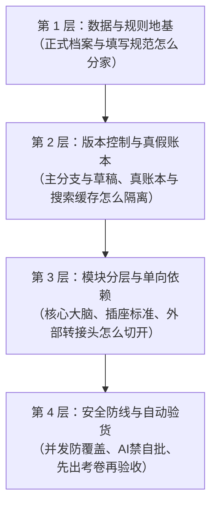

# 零基础总控避坑指南：为什么不先学写代码？

> **核心观点**：在 AI 帮你写代码的时代，你的位置不是“搬砖的泥瓦匠”，而是“看施工图纸和带队验房的业主总控”。

## 1. 先避开零基础最大的坑

很多没有编程背景的创作者，一开始想“搞懂自己的 AI 项目”，往往会去买《Python 从入门到精通》，花三个月背变量、循环和语法细节。结果却是：**语法背了一堆，等 AI 交上来一份架构方案时，依然不知道它改得对不对、会不会把原有功能改崩。**

在 AI 辅助编程（Vibe Coding）场景下，你真正要补齐的只有 **4 层工程判断力**：

---

## 2. 6 周系统学习地图（每周 3–5 小时）

无需赶进度，按“每周看懂一块拼图 + 在自己日常对话里用一次”的节奏推进：

| 周次 | 主题 | 你将彻底搞懂什么 | 当前版本状态 |
| :--- | :--- | :--- | :--- |
| **[Week 1](/guide/week-01-data-rules)** | 数据与规则地基 | 终端命令行、路径防穿越红线、JSON 档案与 JSON Schema 规则表 | ✅ `v0.1` 完整精讲 |
| **[Week 2](/guide/week-02-git-truth)** | 版本控制与真假账本 | Git 分支隔离、工作树、权威文本源 vs 可重建 SQLite 搜索索引 | 🧭 预习导览（`v0.2` 精讲） |
| **[Week 3](/guide/week-03-oop-layers)** | 架构思维与单向分层 | 面向对象封装、耦合痛点、单向依赖、端口（插座）与适配器 | 🧭 预习导览（`v0.3` 精讲） |
| **[Week 4](/guide/week-04-concurrency-guard)** | 并发、事务与人机隔离 | 乐观锁版本号、核态锁、WAL 草稿本、防篡改指纹、AI 禁自批 | 🧭 预习导览（`v0.4` 精讲） |
| **[Week 5](/guide/week-05-tdd-migration)** | 自动化测试与无损重构 | TDD（先立考题）、架构棘轮（只紧不松）与绞杀者渐进改造 | 🧭 预习导览（`v0.5` 精讲） |
| **[Week 6](/guide/week-06-packaging-boundary)** | 平台边界与打包分发 | 纯业务内核 vs 本机不可打包依赖（系统锁/签名/本地工具） | 🧭 预习导览（`v0.6` 精讲） |

---

## 3. 建议怎么搭配使用本套工具？

1. **先读知识库，不求一次背熟**：遇到陌生黑话，随时去查 [大白话术语翻译表](/toolkit/glossary)。
2. **卡壳时召唤“零基础导师”**：去 [AI 陪学套件](/ai-kit/) 复制 `arch-tutor` 提示词，把你看不懂的章节或术语丢给任意 AI，让它用生活比喻给你讲透。
3. **学完一章就去“验货闯关”**：用 `arch-examiner` 考官模拟一次总控审校，练习用 [总控审校 AI 10 条反问清单](/toolkit/review-checklist) 抓出 AI 方案里的偷懒暗坑。
4. **带着自己的项目实战体检**：用只读的 `arch-auditor` 给自己正在做的 AI 项目做一次红/黄/绿灯体检。

> 准备好之后，直接进入 [Week 1：数据与规则地基](/guide/week-01-data-rules) 或先看一眼贯穿全书的 [TALOS-Lite 6 大积木全景](/talos-lite/overview)。
