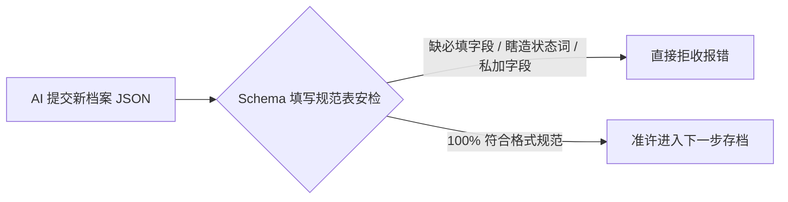

# Week 1：数据与规则地基（终端、路径安全、JSON 与 Schema）

> **本周学习预算**：3–5 小时（通俗科普 1.5h + 本章精读与样本对照 1.5h + 自检与考官演练 1h）  
> **对应 `TALOS-Lite` 积木**：[状态账本 & 工作区边界](/talos-lite/overview)  
> **状态**：✅ `v0.1` 完整精讲版

---

## 本周你要打通的 3 个恐惧

零基础同学一看到程序员的黑框框（终端）、带斜杠的路径和满屏花括号 `.json` 文件就头晕。本周学完，你只需要做到 3 件事：
1. **不再怕终端命令行**：看懂它只是把鼠标点的“按钮”变成了“文字指令”。
2. **认得出路径里的“翻墙陷阱”**：知道为什么专业项目死守“相对路径”而严防“绝对路径”、“`..` 跳转”和“快捷方式/软链接”。
3. **分得清“档案本身（JSON）”与“填写规范表（Schema）”**：这是防住 AI 把系统数据写坏的第一道门。

---

## 一、生活类比拆解 3 个核心概念

### 1. 终端命令行（CLI）= 把餐厅图片菜单换成文字点菜单
- 你平时用微信、浏览器，靠鼠标点一个按钮触发功能，这叫**图形界面（GUI）**。
- 程序员和 AI 控制工具常用的黑框，叫**命令行（CLI）**。它干的还是点菜的事，只是换成打字：`./工具名 动词 目标`。
- 比如在控制底座里输入 `./talosctl read-model show`，翻译成人话就是：“**调用总控工具，执行‘展示只读汇总视图’这个动作**”。

### 2. 文件路径安全 = 公司门禁卡只能刷本栋楼，不准拿万能钥匙翻墙
在项目工程里，文件的位置（路径）有两种常见写法，也是 AI 最容易犯错、甚至带来安全隐患的地方：

| 路径写法 | 示例 | 大白话解释 | 为什么总控要管住它？ |
| :--- | :--- | :--- | :--- |
| **相对路径** | `projects/demo/state.json` | “从当前项目大门走进去，找第 2 个柜子里的文件” | ✅ **安全、可搬家**。把项目拷给别人或放到网上，地址依然有效 |
| **本机绝对路径** | `<HOME>/Desktop/my-secret/data.json` | “从这台电脑硬盘最底层、带张三用户名一路找下去” | ❌ **高危**。既暴露本机隐私用户名，拷到别人电脑上也绝对打不开 |
| **上级跳转 `..`** | `../../etc/passwords` | “先走出大门，再往外倒退两层翻进别人家院子” | ❌ **越界漏洞**。恶意或出错的 AI 可能借此逃出工作目录改系统文件 |
| **软链接（Symlink）** | 一个看似在屋里、实际指向屋外秘密抽屉的“传送门/快捷方式” | 看似合法在项目里读写，一落笔其实改到了屋外敏感目录 | ❌ **绕过门禁**。严肃控制系统在打开关键文件前必须拦截快捷方式 |

### 3. JSON 与 JSON Schema = “空白病历本”和“医院填写规范表”

- **JSON（`.json`）** 是装具体数据的电子档案，一共就靠两种括号打天下：
  - **花括号 `{ "字段名": 值 }`**：相当于一张**名片**（一条一条键值对）。
  - **方括号 `[ "第一项", "第二项" ]`**：相当于一张**清单列表**。
- **JSON Schema（`.schema.json`）** 不是数据本身，而是**检查这份 JSON 填得合不合格的“填写规范表”**：
  - 规定哪些格**必填**（`required`）；
  - 规定状态只能从特定词里选（`enum`，比如只允许 `active` 或 `blocked`，不许 AI 自己发明一个 `"almost_done"`）；
  - 规定版本数字必须 `>= 0` 的整数、不能瞎填负数或字母；
  - 规定 **不准私自加塞未登记的字段**（`additionalProperties: false`）。

---

## 二、对照 `TALOS-Lite` 真实脱敏样板

下面是一份完全脱敏、虚构示例项目 `demo-habit-tracker` 的最小状态档案与规范表。不用背代码，对照左右解释看 3 分钟就能读懂：

### 样板 A：真实状态档案（`state-sample.json`）

<<< ../talos-lite/examples/state-sample.json

**总控视角重点看这 4 行**：
- `"$schema": "./state-schema-sample.json"`：它自己声明“我归隔壁那张规范表管”；
- `"revision": 4`：这是第 4 版快照，后续用于防两个 AI 同时改写互相覆盖（第 4 周会讲）；
- `"active_outcome"` 与 `"next_action"`：强制任何项目任何时候都聚焦在“唯一目标 + 明确下一步”，避免 AI 做着做着跑偏；
- 整份文件里**没有任何绝对本机路径，也没有具体流水历史**，保持极度精简，AI 每次读取成本极低。

### 样板 B：对应的填写规范表（`state-schema-sample.json`）

<<< ../talos-lite/examples/state-schema-sample.json

**总控视角重点看这 3 条死规矩**：
- `"const": 3`（第 14 行）：版本架构号写死必须是 `3`，防止旧版格式混进来把程序读崩；
- `"enum": ["planned", "active", "blocked", "completed", "archived"]`（第 18 行）：把状态词关进笼子，AI 再聪明也不能自创状态；
- `"additionalProperties": false`（第 42 行）：彻底堵死 AI “顺手多塞一个备注字段上去”的坏习惯，防止核心状态表膨胀成垃圾堆。

---

## 三、精选外部免费通俗资源（本周约 1.5 小时）

不需要买任何课程，以下公开免费内容与本周主题完美互补：
1. **视频（强烈推荐，约 20 分钟）**：B 站搜索 **《Crash Course 计算机科学速成课》**，本周只看 **第 17 集《操作系统》** 与 **第 20 集《文件系统》**（全程中文配音/字幕动画，彻底建立文件夹、文件权限与系统内核的直观画面）。
2. **图文（约 15 分钟）**：菜鸟教程搜索 **“JSON 教程”**，只看 **“JSON 简介”** 和 **“JSON 语法”** 两页即可，不要往下学 JavaScript 解析代码。
3. **补充小常识（约 10 分钟）**：搜索引擎了解 **“什么是相对路径与绝对路径”**、**“什么是软链接 Symlink”**。

---

## 四、本周过关自检（3 题小测）

试着用自己的话先想一想答案，再点开参考思路核对：

**第 1 题**：AI 帮你在项目里加了一个新功能，主动汇报说：“为了方便排查问题，我在 `state.json` 里新增了一个 `debug_author_home` 字段，存了您电脑上的文件存放路径。”——请问这违反了本周哪 **两条** 红线？

点开核对参考思路

1. **违反 Schema 规范**：如果规范表设了 `additionalProperties: false`，私自新增未声明的字段属于违规污染结构；
2. **违反路径隐私与可移植红线**：把本机绝对路径写进核心状态文件，既泄露本机用户名隐私，也会导致项目换台电脑就失效。

**第 2 题**：为什么不能只在代码里写“口头提醒 AI 按这个格式填 JSON”，而必须把规则写进独立的 `.schema.json` 文件里由程序自动校验？

点开核对参考思路

因为大语言模型是概率生成的，“口头提醒”存在漏看、遗忘或长对话后飘移的风险；而 `JSON Schema` 是确定性的机器规则门禁——哪怕 AI 偶尔犯糊涂，机器安检会在落盘前 100% 把不合格数据拦在门外（详见术语表 [Fail-Closed](/toolkit/glossary#fail-closed)）。

**第 3 题**：假设你想查看某个只读目录里的文件，却发现它其实是一个指向你电脑隐私文件夹的快捷方式（软链接），严谨的架构为什么要拒绝读取它？

点开核对参考思路

防止“表面合规、实际越界”。如果只检查字面路径前缀而不检查节点是不是软链接，程序就可能被骗去读取或覆盖项目范围之外的敏感文件。

---

## 五、召唤 AI 陪练巩固本周

1. **有概念没彻底听懂？** 去 [苏格拉底零基础导师](/ai-kit/tutor) 复制提示词，给 AI 发：“*我是零基础，刚看完 ArchPilot 第 1 周，请用生活类比确认我是不是真的理解了 JSON Schema 和路径安全。*”
2. **想实战过一遍验货？** 去 [“老板验货”模拟考官](/ai-kit/examiner) 复制提示词，给 AI 发：“*请开启 Week 1 关卡！*”
3. **准备好了就往前看**：可以先浏览 [Week 2：版本控制与真假账本（预习）](/guide/week-02-git-truth) 或随时翻阅 [大白话术语翻译表](/toolkit/glossary)。
