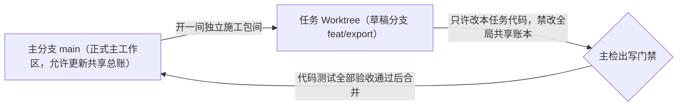

# Week 2：版本控制与真假账本（Git 分支隔离与 SQLite 派生索引）

> **本周学习预算**：3–5 小时（交互练手 1.5h + 本章精读与样板对照 1.5h + 自检与考官演练 1h）  
> **对应 `TALOS-Lite` 积木**：[工作区边界 & 状态账本](/talos-lite/overview)  
> **状态**：✅ `v1.0` 完整精讲版

---

## 本周你要打通的 3 个困惑

1. **总听 AI 说“切个分支 / 建个 worktree”，到底在防什么？** 为什么不直接在一个文件夹里改？
2. **为什么任务分支上写代码没事，一碰全局总目录（如 `portfolio.json`）就被拦住？**
3. **总听人说 `SQLite` 数据库、缓存、汇总视图……哪些文件丢了会死人，哪些文件删了 1 秒能重算？**

---

## 一、生活类比拆解 3 个核心概念

### 1. Git 分支与工作树（Branch & Worktree）= 大楼装修的“安全施工样板间”
- 你可以把主分支（`main`）想象成**正在营业的大楼总前台**，所有正式登记、项目状态和可用版本都挂在这里。
- 每次你想让 AI 开发一个新功能（比如“导出周报”），如果直接在大堂前台敲墙砸地，改到一半客户来访、或者改错了，整栋楼一起停摆。
- **Git 分支（Branch）**就是从当前版本瞬间复制出一套独立的**施工记录线**；而 **工作树（Worktree）** 更进一步，在电脑硬盘上直接多开一间**物理隔离的施工包间**。AI 可以在包间里放心敲代码、跑测试，等全部验收绿灯了，再把成果合规并回总前台。

### 2. 主检出写门禁（Primary Checkout Guard）= 施工包间严禁私印“公司总公章”
假设你同时开了 2 个 AI 分别在包间 A 和包间 B 修不同的功能。如果包间 A 的 AI 顺手去改了 `portfolio.json`（公司总目录），包间 B 的 AI 也顺手去改了它，合并时就会瞬间打架、甚至把别人的已验收进度覆盖掉。  
因此，严格的控制底座立下一条铁律：**“共享总账只能在唯一的注册主工作区、且处于指定主分支上才能写”**；任务草稿区里只改任务自己的代码和局部文档。

### 3. 权威事实源（Truth）vs 派生索引（Derived Index）= “公司纸质正本账” vs “Excel 快速检索表”
初学者最常犯的错误，是以为后缀名带 `.db`、`.sqlite` 的数据库才是老大，文本 `.json` 只是顺手导出的。恰恰相反，在本地优先的智能体系统里：

| 分类 | 常见文件 | 生活类比 | 损坏或丢失后果 | 黄金原则 |
| :--- | :--- | :--- | :--- | :--- |
| **权威事实源（Truth）** | `state.json`、`state-events.jsonl`、`portfolio.json` | **盖着红章的正本原始账册** | 致命损失，无法凭空捏造历史 | 必须靠严格版本校验 + 事务写入死守 |
| **派生索引 / 视图** | `derived-index.sqlite`、`read-model-cache.json`、生成的汇总 Markdown | **为了查得快而手抄的目录卡片盒** | **零业务损失**，触发一次重扫重建即可恢复 | **永远只能单向生成，严禁反过来覆盖正本** |

---

## 二、对照 `TALOS-Lite` 脱敏样板逐段解码

### 样板 A：工作区隔离绑定（`workspace-binding-sample.json`）

<<< ../talos-lite/examples/workspace-binding-sample.json

**总控视角重点看这 4 个字段**：
- `"classification": "PRIVATE"`：工作区物理路径属于这台电脑的私人拓扑信息，绝不放进打算开源的公开仓库里；
- `"binding_kind": "primary"` + `"expected_branch": "main"`：全仓库只承认唯一一个“主检出入口”，认准了才允许写共享状态；
- `"task_isolation": true` + `"daily_entry_only": false`：启用任务隔离门禁后，强迫任何任务都必须走清晰分支流程；
- `"demo-feature-worktree"`：这个施工包间里只跑新功能代码，碰共享总账一律被门禁弹回。

### 样板 B：真账本 vs 派生索引分级表（`truth-vs-index-sample.json`）

<<< ../talos-lite/examples/truth-vs-index-sample.json

**总控一眼看懂的判断法**：以后只要 AI 跟你说“我把状态存进了一个新的 SQLite 缓存库里”，你就追问一句：**“如果我把这个 `.sqlite` 文件直接删掉，数据还能从文本账本里 100% 算回来吗？”**——能算回来，它就只是健康的加速索引；算不回来，它就偷偷变成了第二套平行账本（高危冲突隐患）。

---

## 三、精选外部免费科普资源（本周约 1.5 小时）

1. **交互闯关网站（强烈推荐，免费，约 40 分钟）**：浏览器搜索 **“Learn Git Branching”**，选简体中文，只玩第一大章“主要（Main）”的 **第 1–4 关**。像玩拼图一样直观看到“分支分叉”与“合并”到底怎么回事。
2. **科普短视频（免费，约 15 分钟）**：B 站搜索 **“10 分钟看懂什么是数据库和 SQLite”**，建立“单文件本地表格库”的直观画面即可，完全不需要学写 SQL 查询语言。

---

## 四、本周过关自检（3 题小测）

**第 1 题**：AI 在帮你做一个新页面时说：“为了顺便记录这个功能的进度，我在当前开发分支顺手把总目录 `portfolio.json` 更新了。”——为什么控制底座的门禁会拒绝这步操作？

点开核对参考思路

`portfolio.json` 属于全局共享权威账本。如果在多个并行开发的草稿分支里各自修改共享账本，合并时极易发生冲突或静默覆盖；正确做法是在唯一受控的主检出目录按版本锁更新共享状态，任务分支只管好自己的功能范围。

**第 2 题**：为什么“本地搜索索引（SQLite 数据库）”损坏后可以直接删除重建，而 `state-events.jsonl` 损坏却不行？

点开核对参考思路

`SQLite` 索引库里的数据是从原始 JSON 和事件流水里抽取加工出来的**派生视图**，源头还在就能重新生成；而 `state-events.jsonl` 记录着每一次状态演进的历史事实与防篡改收据，是**唯一权威事实源**，丢了就没有“源头”可重建。

**第 3 题**：为什么系统要求同一个仓库最多只能登记 **1 个** `primary`（主检出）绑定，且私人工作区绑定表必须标记为 `PRIVATE`？

点开核对参考思路

1. 存在两个主检出入口会导致共享总账写入门禁失效（两头都能写等于没锁）；
2. 绑定表里存着本机硬盘路径与个人工作结构，标为 `PRIVATE` 并与公开仓库物理隔离，可以彻底杜绝隐私路径被随手提交到公开网络。

---

## 五、召唤 AI 陪练与下一步

- **没完全消化？** 去 [苏格拉底零基础导师](/ai-kit/tutor) 发送：*“刚学完 ArchPilot Week 2，请用生活类比考考我是否真懂了工作区隔离和真假账本。”*
- **检验实操敏感度**：去 [“老板验货”模拟考官](/ai-kit/examiner) 发送：*“请开启 Week 2 关卡！”*
- **继续推进**：前往 [Week 3：架构思维与单向分层](/guide/week-03-oop-layers)。
