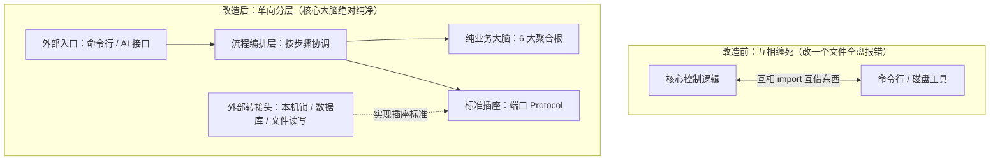

# Week 3：架构思维与单向分层（OOP 领域模型、耦合、端口与适配器）

> **本周学习预算**：3–5 小时（概念图解 1.5h + 样板与实战复盘精读 1.5h + 自检与考官演练 1h）  
> **对应 `TALOS-Lite` 积木**：[六大领域积木与单向分层](/talos-lite/overview) ｜ [双向耦合改造实战复盘](/talos-lite/refactor-walkthrough)  
> **状态**：✅ `v1.0` 完整精讲版

---

## 本周你要打通的 3 个困惑

1. **总听架构师说“面向对象建模（OOP）、聚合根、不变量”，到底跟我指挥 AI 写功能有什么关系？**
2. **为什么小项目一开始写得飞快，功能加到十几个就开始“改 A 坏 B”？**（双向耦合的真实病因）
3. **“端口（Protocol）”和“适配器（Adapter）”听起来像天书，怎么用一句人话看穿它？**

---

## 一、生活类比拆解 3 个核心概念

### 1. 面向对象领域建模 = 给核心业务请“部门大管家”，绝不让外人乱翻抽屉
不要被教科书上的“猫狗继承动物”误导了。工程架构里真正有用的面向对象思想，只做一件事——**把“关键数据”和“管住数据的死规矩”锁进同一个屋子里**，由“部门大管家”全权把门：

- **聚合根（部门大管家）**：比如 `ProjectState`（状态账本管家）。外面任何界面或 AI 想改项目进度，必须递交请求调用管家的方法，管家核对无误才准改。**绝对不准外人直接绕过管家修改里面的某个零件**。
- **值对象（填完塑封的发票）**：比如版本号、加密指纹、合法路径。一旦生成就不能拿橡皮擦涂改，错了只能作废重开一张新的。
- **不变量（公司的死红线）**：大管家无论怎么干活都绝不能打破的底线（比如“流水号必须连续”“AI 提议不能自己点通过”）。

### 2. 双向依赖 vs 单向分层 = “两部门互相卡死” vs “自来水只许高往低流”
当项目没有分清边界时，最容易长出下面左边这种“蜘蛛网”；而健康架构则像右边这样**只能单向流动**：

### 3. 端口（Port / Protocol）与适配器（Adapter）= “墙上的国标插座”与“电器转接头”
- **端口（插座标准）**：核心大脑墙上只留一个三孔插座，明确写着“我需要一个能加锁/解锁的设备”。大脑**完全不关心**插进来的到底是 Mac 系统的内核锁、Windows 的锁，还是测试环境里的内存假锁。
- **适配器（转接头）**：就是把某种具体电脑环境、某个数据库或某家 AI 接口，翻译成核心大脑插座标准的“中间翻译官”。
- **惊人好处**：只要插头规范不变，以后把本地文件换成云端数据库、或者在完全没有硬盘的沙箱里跑全套核心逻辑，**核心大脑一行代码都不用改**！

---

## 二、对照 `TALOS-Lite` 脱敏样板逐段解码

你不需要懂 Python 语法，只需要用**总控视角**看懂下面这份不到 40 行的文件里谁在管谁：

<<< ../talos-lite/examples/port-protocol-sample.py

**总控一眼看懂这 3 块分工**：
1. **`LockPort(Protocol)`（第 7–11 行）**：这就是墙上的**国标插座**，只规定“必须有 `acquire` 这个加锁动作”，里面一行具体实现代码都没有。
2. **`MemoryFakeLock`（第 14–27 行）**：这是一个**测试专用的内存假插头**，完全不碰真实硬盘。以后你想验证“两个人同时抢同一把锁会不会报错”，用这个假插头 0.001 秒就能测完，不用真的去锁电脑文件。
3. **`update_project_summary(lock: LockPort, ...)`（第 30–33 行）**：这就是**纯业务大脑**。注意看它从头到尾没有 `import` 任何 macOS、Windows、数据库或命令行工具——外面的世界怎么变，大脑都稳如泰山。

> 想看真实复杂底座是怎么从“30 条双向坏依赖”一步步切成这种干净分层的？强烈建议连读配套实战文：[双向耦合改造实战复盘](/talos-lite/refactor-walkthrough)。

---

## 三、精选外部免费科普资源（本周约 1.5 小时）

1. **图解概念（免费，约 30 分钟）**：在 B 站或知乎搜索 **“通俗图解六边形架构 / 端口与适配器（Ports and Adapters）”**，重点看“业务核心在中间、外部数据库/界面都在外圈插上去”的结构图，跳过具体语言语法。
2. **设计原则科普（免费，约 30 分钟）**：搜索 **“大白话讲依赖倒置原则（DIP）与高内聚低耦合”**，重点把“高层不直接依赖底层细节，双方共同依赖抽象接口”和我们讲的“插座比喻”对应起来。
3. **本库工具对照（15 分钟）**：对照重读 [术语表 - 依赖与分层篇](/toolkit/glossary#coupling)。

---

## 四、本周过关自检（3 题小测）

**第 1 题**：编程 AI 向你汇报：“为了写代码方便，我让核心业务计算模块直接引用了命令行界面里的提示弹窗工具，这样报错可以直接弹窗。”——请问这犯了本周哪条架构大忌？会有什么后果？

点开核对参考思路

犯了**“反向依赖”**大忌：核心业务大脑直接绑死了最外层的命令行界面工具。后果是：以后你想把这套业务放进网页端、MCP 接口或无界面后台脚本里运行时，会发现只要一导入核心模块就会报错，根本拆不出来复用。

**第 2 题**：为什么“端口（Protocol）”在核心架构里自己不写具体干活的代码，只写几行空要求？这不是多此一举吗？

点开核对参考思路

绝不是多此一举。它的作用就像国家电网定下“三孔插座标准”：把**“我需要什么能力”**（业务需求）和**“具体用哪家硬件/数据库实现”**（技术细节）彻底隔开。这样既能随时把测试假插头插上去飞快跑自动验收，也能将来无缝替换底层存储而不伤业务大脑。

**第 3 题**：为什么 `update_project_summary` 不允许外人绕开大管家直接把状态字段改掉？

点开核对参考思路

为了守住**不变量（死红线）**。如果每个外部脚本都能直接改某一个字段，那么版本号递增、防篡改指纹重算、字段格式校验这些联动规矩迟早会被其中某个忘记更新的人漏掉，整个账本就会从内部腐烂。

---

## 五、召唤 AI 陪练与下一步

- **卡在“插座和依赖方向”？** 去 [苏格拉底零基础导师](/ai-kit/tutor) 发送：*“请用插座和转接头的比喻，考考我 Week 3 的端口、适配器与单向分层。”*
- **实战抓虫演练**：去 [“老板验货”模拟考官](/ai-kit/examiner) 发送：*“请开启 Week 3 关卡！”*
- **继续推进**：前往 [Week 4：并发、事务与人机隔离](/guide/week-04-concurrency-guard)。
