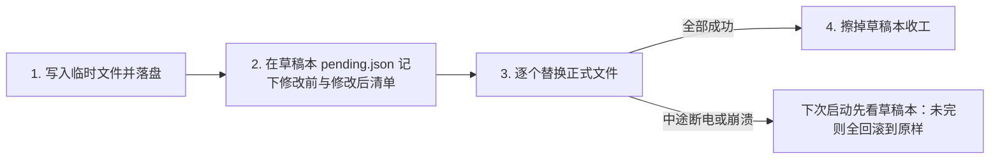

# Week 4：并发、事务与人机隔离（乐观锁、WAL、收据链与防 AI 自批）

> **本周学习预算**：3–5 小时（通俗科普 1.5h + 本章精读与样板对照 1.5h + 自检与考官演练 1h）  
> **对应 `TALOS-Lite` 积木**：[待审提议箱 & 执行安检门 & 状态账本](/talos-lite/overview)  
> **状态**：✅ `v1.0` 完整精讲版

---

## 本周你要打通的 3 个困惑

1. **如果同时开着 Claude 和 Codex 两个 AI 帮我改同一个项目，怎么防止它们互相把对方的进度覆盖掉？**
2. **万一电脑改文件改到一半突然断电或程序崩溃，怎么确保不会留下“一半新一半旧”的残废账本？**
3. **AI 既然有权力读取项目、也能帮我改方案，我怎么从系统架构上防止它“自己提方案又自己点同意生效”？**

---

## 一、生活类比拆解 4 道安全防线

### 1. 防并发写花的三重门：门闩（POSIX 锁）+ 核对版本号（乐观锁）+ 核对原件（字节级 CAS）
- **第一重门：核态门闩（POSIX 锁）**  
  就像由大楼保安亲自控制开关的**卫生间门闩**。同一时刻只准一个程序进门写核心账本；万一写到一半程序意外崩溃闪退，操作系统会自动把门闩弹开，不会卡死。找不到支持核态锁的系统时宁可报错拒写（[Fail-Closed](/toolkit/glossary#fail-closed)），绝不“敞开门大家一起冲进去写”。
- **第二重门：乐观锁（`expected_revision`）**  
  假设 AI 甲和 AI 乙先后都读到了 `第 4 版`。甲先提交，系统升级成了 `第 5 版`。等乙拿着 `我是基于第 4 版改的` 来提交时，系统立刻当场拦截报错（`ConflictError`）：“版本号过期了，请重新读第 5 版再改！”——**绝不偷偷盖掉甲的成果**。
- **第三重门：字节级 CAS（落笔前核对原件）**  
  就算版本号一致，正式替换文件前最后一毫秒，系统还会核对一遍硬盘里此刻的原始字节是不是跟刚才读到的一模一样——防止有人在门外偷偷手动改过文件。

### 2. WAL 预写草稿本 = 断电也不留半截烂账的秘密

如果一次操作要同时改 `state.json`、`state-events.jsonl` 和 `portfolio.json` 三个文件，绝对不能直接依次覆盖原文件——万一改完第 1 个突然停电，系统就废了。**WAL（预写日志）**就像先在草稿本里记下“原件是什么、准备改成什么”，替换完再撕掉草稿本；出意外重启时对照草稿本一恢复，**要么全成功，要么 100% 退回修改前**。

### 3. 防篡改收据链（SHA-256）= 给每页银行流水盖骑缝防伪章
任何内容只要经过哈希计算（SHA-256），就会生成一个独一无二的 64 位指纹——**哪怕有人偷偷把文件里的一个标点改了，指纹就会变得面目全非**。状态账本的每一步变更都串成带前序指纹和快照指纹的“收据链”，任何人绕过正门去硬盘手改 `state.json`，下一次启动校验立刻当场抓现行。

### 4. 人机权限隔离墙 = 给 AI “投递箱”，但把“批准公章”留在人类手里
很多 AI 应用为了省事，把“提交修改建议”和“确认写入生效”做在同一个工具接口里。这极其危险——相当于把审批印章直接挂在申请箱上。  
成熟架构的做法是**物理隔离**：
- 给 AI 使用的 MCP 插口里，只提供“只读查询”与“把修改申请单放进 `ProposalInbox`（待审提议箱）”；
- **批准生效（`confirm`）与回滚（`rollback`）的命令刻意根本不做进 MCP 工具清单里**，只留给人类总控在本地界面或命令行点击拍板。

---

## 二、对照 `TALOS-Lite` 脱敏样板逐段解码

### 样板 A：AI 投递的待审提议单（`proposal-sample.json`）

<<< ../talos-lite/examples/proposal-sample.json

**总控视角重点看这 4 处保险丝**：
- `"expected_revision": 4` & `"expected_portfolio_revision": 12`：**双版本号乐观锁**，项目进度变了或者总目录变了，这张申请单都会自动作废，防止过时修改误伤现状；
- `"request_sha256": "9f86..."`：**请求内容防篡改指纹**。你批准前看到的是什么内容，落账时就必须逐字对得上这个指纹，防止中途被悄悄掉包；
- `"status": "pending"` + `"allowed_approver": "local-owner-only"`：AI 交上来的永远只是“待审批态”，最终审批权死死锁在本地人类所有者的手里。

### 样板 B：连续加密收据流水（`event-chain-sample.jsonl`）

<<< ../talos-lite/examples/event-chain-sample.jsonl

**总控一眼看懂的规矩**：每一行是一条不可倒改的历史动作，`revision` 必须从 `0, 1, 2...` 严格递增；每条的 `transition_receipt` 都咬住上一条日志和当前快照指纹，彻底堵死“改了结果却不留痕迹”的漏洞。

---

## 三、精选外部免费科普资源（本周约 1.5 小时）

1. **并发防撞科普（免费，约 25 分钟）**：B 站或图文搜索 **“大白话讲悲观锁和乐观锁（CAS）”**，重点记住“排他门闩（悲观锁）”和“先读版本号、提交时核对（乐观锁）”分别适合什么场景。
2. **事务与崩溃恢复科普（免费，约 25 分钟）**：搜索 **“什么是数据库事务 ACID 与 WAL 预写日志通俗原理”**，对照本文第 2 节的草稿本流程图理解“要么全成、要么全回滚”。
3. **防篡改指纹科普（免费，约 15 分钟）**：搜索 **“什么是 SHA-256 哈希值防篡改”**，了解为什么改 1 个空格指纹就全变。

---

## 四、本周过关自检（3 题小测）

**第 1 题**：AI 提议在 MCP 工具箱里再多加一个 `auto_approve_my_proposal`（自动审批我的提议）工具，说“这样可以省得您每次自己点确认，实现全自动”。作为总控，为什么必须严词拒绝？

点开核对参考思路

这会彻底击穿**人机权限隔离防线**。一旦审批功能出现在 AI 可调用的工具列表里，大语言模型在长对话幻觉、提示词注入或误判时就可能越权修改核心权威账本。哪怕再追求效率，“提案权”与“终审拍板权”也必须物理分家。

**第 2 题**：为什么已经有了“版本号乐观锁”，系统在写入硬盘前还要多做一道“草稿本 WAL + 字节级核对”？

点开核对参考思路

1. 乐观锁只管“并发逻辑版本号有没有过期”，管不了“写到第 2 个文件时电脑突然断电”；WAL 草稿本负责**崩溃恢复原子性**；
2. 字节级核对负责防止在软件检查通过到真正覆盖文件那极短一瞬间，有外部工具或人工直接修改了硬盘原文件。

**第 3 题**：如果某个同学为了省事，用文本编辑器手工打开 `state.json` 把里面的 `"revision"` 从 `4` 改成了 `5`，后续运行校验会发生什么？

点开核对参考思路

会在 `verify_integrity` 阶段当场被拦下报错！因为流水账 `state-events.jsonl` 里的最后一条事件编号还是 `4`，而且尾事件里携带的加密收据指纹算出来依然对应修改前的原文，与手改后的 `state.json` 完全对不上。

---

## 五、召唤 AI 陪练与下一步

- **想用生活例子再顺一遍锁和 WAL？** 去 [苏格拉底零基础导师](/ai-kit/tutor) 发送：*“请逐个考考我 Week 4 的乐观锁、WAL 草稿本和防 AI 自批隔离。”*
- **实战挑刺过关**：去 [“老板验货”模拟考官](/ai-kit/examiner) 发送：*“请开启 Week 4 关卡！”*
- **继续推进**：前往 [Week 5：自动化测试与无损重构](/guide/week-05-tdd-migration)。
