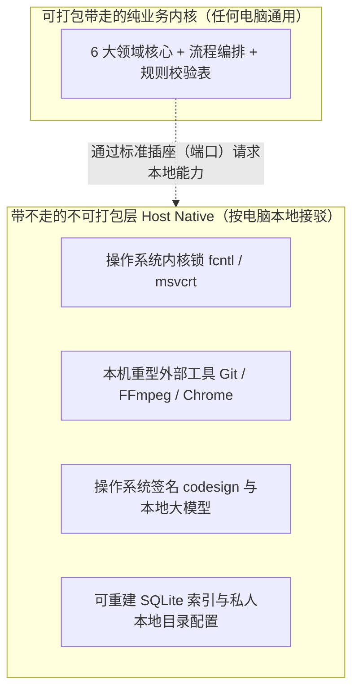

# Week 6：平台边界、MCP 与毕业综合实战（可移植内核 vs 不可打包层）

> **本周学习预算**：3–5 小时（概念科普 1h + 样板对照 1.5h + 毕业大考与真实项目体检 1.5h）  
> **对应 `TALOS-Lite` 积木**：[能力身份证 & 工作区边界 & 统一 AI 插口](/talos-lite/overview)  
> **状态**：✅ `v1.0` 完整精讲版

---

## 本周你要打通的 3 个困惑

1. **为什么一个程序在我自己电脑上跑得好好的，打包发给朋友或换台电脑就报错打不开？**
2. **总听说的 `MCP`（Model Context Protocol）到底是什么？它跟“能力身份证（Manifest）”有什么关系？**
3. **学完这 6 周之后，面对一个真实的 AI 编程项目，我该用哪一套固定动作来做验收与体检？**

---

## 一、生活类比拆解 3 个核心概念

### 1. 纯业务内核 vs 不可打包层 = 搬家时“打包带走的家具” vs “留在原屋的水电管线”

如果你把本地文件锁、macOS 专属应用签名脚本、特定路径下的本地大模型或者个人电脑的私人目录路径全部揉进核心代码里，这个软件就**彻底失去了可移植性**——就像把墙里的自来水管和电表焊死在衣柜上，根本没法搬家打包分发。  
高级架构的做法是物理分家：**“可打包内核（Pure Core）”只包含纯粹、跨平台的业务规则，放到任何纯净环境里都能独立跑通全部核心测试；所有“不可打包的本机绑定（Host Native）”全部留在最外层作为可选插件按端口接驳。**

### 2. MCP = AI 世界的统一 USB-C 接口
以前每家 AI 助手（Claude、ChatGPT、Cursor 等）各自有一套连接外部工具的方言，同一个项目要写五六份胶水代码。**MCP（Model Context Protocol）**就像行业统一规定的 **USB-C 标准插口**：你的控制系统只要按标准暴露一组受控工具（比如“读焦点”“查进度”“投递修改提议”），任何支持 MCP 的 AI 插上去就能用完全同一套规矩干活，再也不用担心不同 AI 各干各的把账本搞乱。

### 3. 能力身份证（Capability Manifest）+ Fail-Closed（失效即关闸）
任何外部插件、扩展能力想接入控制系统，不能直接丢一段代码就跑，必须先交一份透明的“入职体检与能力身份证”：
- 你只能读哪些数据（最小权限原则）？
- 要不要往外网发数据（如果外呼，**必须强制每次任务由人类确认，且严禁在配置里夹带密码凭据**）？
- 一旦依赖的磁盘、网络或数据库连不上怎么办？必须遵守 **Fail-Closed（故障闭环）**：立刻拉闸报错停止执行，绝不“检测失败就悄悄放行”。

---

## 二、对照 `TALOS-Lite` 脱敏样板逐段解码

### 插件能力身份证样板（`manifest-sample.json`）

<<< ../talos-lite/examples/manifest-sample.json

**总控视角重点核对这 5 条硬核红线**：
- `"classification": "PUBLIC"`：能力声明本身干净脱敏，可安全分享审查；
- `"action_scopes": []` + `"read_scopes": ["projects.read"]`：只给最小读权限，不开放危险动作权限；
- `"external_reads": [...]` + `"activation_mode": "per-task-confirmation"`：**联动死规矩**——只要声明了需要对外发数据，就强制必须每次任务经过人类确认；
- `"credentials": false`：严禁插件自己私藏硬编码账号密码；
- `"failure_mode": "fail-closed"`：健康信号（`source` / `storage` / `workspace`）任一故障，默认关闸拒绝服务。

---

## 三、精选外部免费科普资源（本周约 1 小时）

1. **AI 接口标准科普（免费，约 25 分钟）**：搜索 **“什么是 MCP（Model Context Protocol）大白话通俗科普”**，结合本文 USB-C 类比理解为什么“统一插口 + 最小权限”能治住多 AI 协作混乱。
2. **跨平台与软件分发常识（免费，约 20 分钟）**：搜索 **“为什么软件需要环境变量、依赖隔离与操作系统签名（codesign）”**，理解为什么“在我电脑能跑”不等于“别人拿去就能直接用”。

---

## 四、毕业过关自检（3 题小测）

**第 1 题**：某插件声明它需要把每周项目摘要同步到外部云端存储，同时在配置里把触发方式写成了 `always-local`（后台静默自动执行），还把一个 API 密钥字段留在了配置里。——作为总控，这份清单哪几处红线必须当场毙掉？

点开核对参考思路

连踩三条安全红线：
1. 只要存在外呼需求（`external_reads` 非空），触发模式强制必须是 `per-task-confirmation`（逐次任务人工确认），绝不准后台静默执行；
2. 禁止在能力清单配置中夹带凭据密钥（`credentials` 必须为 `false`）；
3. 外呼内容必须经过脱敏（只允许 `public-summary`），绝不允许夹带私有数据。

**第 2 题**：为什么“打包独立分发的纯核心软件包”之前，必须要把操作系统锁、本地模型服务和私人目录配置从核心目录物理剥离出去？

点开核对参考思路

因为这些属于绑定特定主机、操作系统或个人隐私环境的**不可打包层**。如果混在纯内核里，不仅跨平台换电脑会直接报错崩溃，还极易在打包开源时把个人隐私路径和平台特有二进制一起泄露或污染构建物。

**第 3 题**：假设你用本地 AI 写完了一个新插件，上线前网络检查突然连不上它依赖的外部索引源，插件为了“用户体验好不报错”，选择了跳过校验直接按空数据继续往下写状态。——这违反了哪条工程铁律？

点开核对参考思路

违反了 **Fail-Closed（故障闭环）** 铁律！在关键控制路径上，校验依赖不可用或数据失联时必须果断关闸阻断并返回明确故障原因；“失效时静默放行（Fail-Open）”会掩盖真实错误，极易造成灾难性的脏数据覆盖。

---

## 五、总控毕业实战两件套（现在就去验收自己！）

恭喜你完成了 ArchPilot 全部 6 周核心思维地图！建议立刻用下面两步完成知识到能力的真正转化：

1. **终极模拟盘问（综合大考）**：  
   打开 [“老板验货”模拟考官](/ai-kit/examiner)，复制提示词后直接发送：**“请开启综合大考！”**（试着只靠自己和 [10 条反问清单](/toolkit/review-checklist)，一次抓出 3 个深藏在不同表述里的工程暗坑）。
2. **给你自己的项目做第一份体检**：  
   打开 [真实项目体检助手](/ai-kit/auditor)，把你手里正在用 AI 开发的真实项目结构发给它，拿到属于你自己的《大白话架构体检报告》与最小步改进路线！

> 还有零散实操疑问？随时翻阅 [零基础总控高频 12 问 FAQ](/guide/faq) 或 [全量 9 份脱敏教学样板速查手册](/talos-lite/examples-index)。
