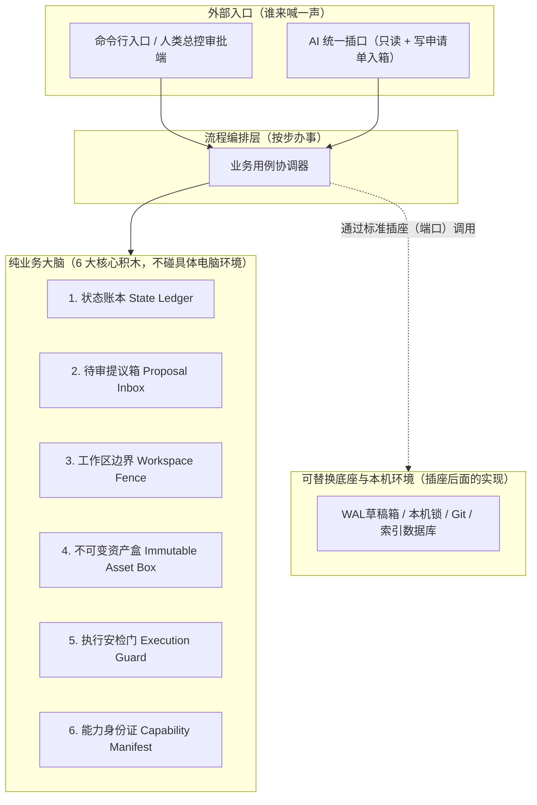

# TALOS-Lite：脱敏简化版智能体控制底座全景

为了不让你在枯燥的“猫和狗继承动物”玩具示例里迷路，全书采用一个来自真实工程控制底座的**完全脱敏、简化教学模型**——`TALOS-Lite`。它去除了所有私人配置、本机绝对路径与复杂业务代码，只保留理解现代 AI 系统架构所需的 **6 个核心积木**。

---

## 1. 为什么 AI 工程需要“控制底座”？

当你让一个或好几个 AI 一起帮你管理项目、改文档、写代码时，最容易出现 4 种失控：
1. **乱改账本**：AI 为了完成当前任务，顺手把项目总状态改坏，或者两个 AI 同时写入互相覆盖；
2. **越权自批**：AI 自己提出一个修改方案，又自己点“批准执行”；
3. **内外不分**：AI 把你电脑上的绝对路径、私人配置文件泄露进打算公开的文件夹；
4. **越改越缠**：所有功能都直接调用彼此，过两周后牵一发而动全身。

`TALOS-Lite` 就是用来解决这 4 种失控的**架构样板间**。

---

## 2. 六大核心积木与单向分层图

---

## 3. 用一句大白话看懂每一块积木

| 积木名称 | 生活类比 | 它死守哪条底线（不变量）？ | 对应重点周次 |
| :--- | :--- | :--- | :--- |
| **1. 状态账本（State Ledger）** | **病历本 + 银行流水单** | 每次修改必须核对上一版版本号；流水编号 `0, 1, 2...` 连续且带防篡改收据 | [Week 1](/guide/week-01-data-rules) / [Week 4](/guide/week-04-concurrency-guard) |
| **2. 待审提议箱（Proposal Inbox）** | **员工请示箱 + 老板印章** | AI 只能往箱子里投“申请单”，绝不暴露“批准盖章”功能给 AI，防自批 | [Week 4](/guide/week-04-concurrency-guard) |
| **3. 工作区边界（Workspace Fence）** | **施工隔离围栏 + 公私门禁** | 草稿分支禁止改主账本；私人配置目录与公开区严格物理隔离；禁止路径穿越 | [Week 2](/guide/week-02-git-truth) / [Week 6](/guide/week-06-packaging-boundary) |
| **4. 不可变资产盒（Immutable Asset Box）** | **封存成品档案袋** | 产物一旦入库编号永不复用、内容按指纹验真，坏了只能报异常或出新版 | [Week 5](/guide/week-05-tdd-migration) / [Week 6](/guide/week-06-packaging-boundary) |
| **5. 执行安检门（Execution Guard）** | **机场过安检** | 没写明任务范围就拒绝高危写操作；命中手改核心账本等禁止路径直接拦下 | [Week 4](/guide/week-04-concurrency-guard) / [Week 5](/guide/week-05-tdd-migration) |
| **6. 能力身份证（Capability Manifest）** | **新员工入职体检表** | 任何插件/工具接入前必须申报读哪些数据、是否外呼、出错是否默认关闸 | [Week 3](/guide/week-03-oop-layers) / [Week 6](/guide/week-06-packaging-boundary) |

---

## 4. 延伸实战与全量样板入口

- **看懂真实系统怎么拆坏依赖**：[实战复盘：如何把双向耦合的旧底座无损切成单向分层？](/talos-lite/refactor-walkthrough)
- **一站翻阅全书全部示例文件**：[TALOS-Lite 全量 9 份脱敏教学样板速查手册](/talos-lite/examples-index)
- **从第 1 周按步精读**：[Week 1：数据与规则地基](/guide/week-01-data-rules)
- **随时查陌生黑话**：[大白话术语翻译表](/toolkit/glossary)
