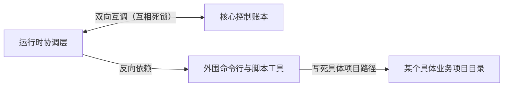
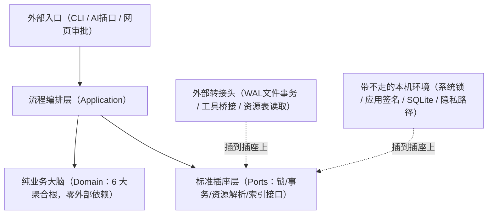

# 实战复盘：如何把双向耦合的旧底座无损切成单向分层？

> **本页解决什么真实难题**：当你自己的 AI 项目跑了几个月、功能越加越多之后，往往会遇到“想拆开打包、却发现所有文件都像蜘蛛网一样互相缠死”。这里用一个完全脱敏的控制底座重构案例，展示专业工程师是怎样**不推倒重来、也不丢掉老防线**，用三把精准切刀把结构理顺的。

---

## 一、改造前：长歪了的三类“蜘蛛网”症状

很多快速长大的项目，都会不自觉滑向下面这 3 种典型结构债：

1. **内部互相咬死（双向导入）**：控制账本要找运行时借系统锁，运行时又要回头调用控制账本里的状态结构——两个模块一荣俱荣、一损俱损，想单独拿去测都拿不出来。
2. **大脑反向依靠手脚（反向依赖）**：负责规则判断的“业务大脑”直接导入外围的命令行界面或文件小工具，导致以后想换一套桌面端或网页界面时，大脑也得跟着大改。
3. **公共内核写死了特定项目路径（硬编码）**：原本应该是通用的系统底座里，直接把某一个业务项目的文件夹名写死在源码里，结果底座根本无法作为独立组件分享给别人用。

---

## 二、为什么坚决不“全部删掉从头写”？

很多 AI 看到上面的乱麻，第一反应都会劝你：“**旧的太乱了，不如新建一个干净项目从零重写！**”  
在有了一定积累的项目里，这通常是最危险的建议，原因只有一句大白话：**老代码里藏着大量真实踩坑才补上的“防盗网”**（比如防路径穿越、防断电写坏半截文件的草稿本、防跨工作树覆盖、防并发写花）。一推倒重写，新项目往往只记得主流程，把一半暗坑防线都弄丢了。

正确做法是**原地绿地（In-Repo Greenfield）+ 绞杀者模式**：在老系统旁边划出一块绝对干净的新区，立好自动检查守卫，用 3 个波次一边通车一边分段替换。

---

## 三、三把精准切刀（怎么把坏依赖剪干净？）

| 痛点类型 | 切刀动作（大白话解释） | 改造后效果 |
| :--- | :--- | :--- |
| **切刀 1：消灭双向互调** | 把纯规矩和流水校验抽进绝对干净的 `Domain` 大脑区；把读写文件、加锁改造成外部实现 `Ports` 插座的独立“转接头”，通过参数传给协调器。 | 控制大脑不再认识具体硬盘文件或锁，内部依赖单向流到底，再也不绕圈。 |
| **切刀 2：砍断反向依赖** | 把命令行交互、AI 接口外移成最外层的入口适配器；核心流程只认 `TaskLifecyclePort` 等抽象插座标准，具体外部脚本挂到最外层执行。 | 以后无论换网页、换桌面 App 还是换新 AI 客户端，核心业务一行不用改。 |
| **切刀 3：拔掉路径硬编码** | 建立统一“资源门牌号查询插座”，底座只喊“我要找品牌资源”，由当前工作区的登记表负责翻译成具体路径。 | 彻底解绑特定业务项目，公共系统底座随时可以独立打包开源。 |

---

## 四、三个波次无损推进节奏（每步都可单独验收）

1. **Wave 1：先立自动验房仪 + 划出纯大脑新区**  
   先把 [架构棘轮](/toolkit/glossary#ratchet) 测试加好，冻结当前坏依赖数量“只准减少不许增加”；然后在 `Domain` 和 `Ports` 新区按 [TDD](/toolkit/glossary#tdd) 先写出防线测试再落地核心对象。旧功能零改动、零中断。
2. **Wave 2：流程接管 + 把坏依赖清零**  
   依次切掉三类反向与双向边，让老入口退化为薄转发壳，把两套散落的提议流程并成统一的待审提议箱。完成后，棘轮基线正式清零锁死。
3. **Wave 3：物理剥离“带不走的本机环境”**  
   把操作系统锁、应用签名、外接重型二进制工具、可重建索引数据库和私人路径配置全部单独迁到外围宿主层；纯业务内核实现在“无任何本机外部依赖”的纯净沙箱里 100% 跑通所有测试。

> **回到对应课程巩固**：[Week 3：架构思维与单向分层](/guide/week-03-oop-layers) ｜ [Week 5：自动化测试与无损重构](/guide/week-05-tdd-migration) ｜ [Week 6：平台边界与打包分发](/guide/week-06-packaging-boundary)
